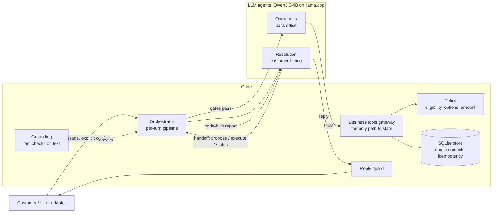

# Architecture

The rule that shapes everything: **agents say yes; code can say no.**

- **The two LLM agents** interpret the customer, choose what to do, start every business action and
  write the reply.
- **Deterministic code** checks the agents' choices against facts. It owns money, stock, commits,
  idempotency and recovery, and it labels each turn's decision. It may **block** (with a reason
  fed back to the agent), **read** (a read-only check, such as reconciling after a timeout) or
  **replay** (a completed request's stored result). It never makes a proposal or a commit itself.

Why this split: the brief requires meaningful agent use and also wants money, authorization and
invariants in deterministic code. The split gives both, and it can be measured. A do-nothing stub
that only asks questions ("always-clarify") runs the same code with no model. It completes **zero**
refunds or exchanges on every suite, so every completed transaction in the results was started by
an agent ([RESULTS.md](RESULTS.md)).

## Components

| Part | LLM or code | Responsibility | Tools / interface |
|---|---|---|---|
| Resolution | LLM | Reads the conversation; picks line, remedy and size; asks or hands off; writes the reply | `find_order_lines`, `handoff_to_operations` (`propose_refund`, `propose_exchange`, `check_status`, `execute_confirmed`), `reply_to_customer` |
| Operations | LLM | Maps the request to a catalog option, proposes, executes after confirmation, reconciles | `list_exchange_options`, `create_proposal`, `execute_proposal`, `get_request_status`, `report_to_resolution` |
| Orchestrator (`desk/orchestrator.py`) | code | Runs a turn: confirmation grant, routing, gates, budgets, decision label, response | n/a |
| Grounding (`desk/grounding.py`) | code | Reads IDs, products, sizes and cues from the text, so code can check the agent's choice | pure functions |
| Policy (`desk/policy.py`) | code | Eligibility (delivered, unopened, not final sale, within 30 days inclusive of the fixture date), exchange options, refund amount = net paid in integer cents | pure functions |
| Gateway (`desk/tools.py`) | code | The only path from agents to state; checks the customer, re-checks at commit, injects faults, audits every call | business tools |
| Store (`desk/store.py`) | code | SQLite; one transaction per commit; proposals bound by a hash; idempotency by request id | SQL |
| Reply guard (`desk/render.py`) | code | Rejects LLM text that states a number, ID or success the facts don't support; then uses a template | n/a |

Operations never sees customer text, only a structured brief: target, intent, requested size,
grant flag. A prompt injection in the customer message therefore cannot reach the agent that
moves stock and money.

## One turn

1. **Faults and confirmation.** Contract faults for this turn apply first, such as stock changes.
   An explicit `confirm_proposal` resolves to the exact proposal shown earlier. The grant is
   withheld when the message cancels or changes the request, whether code reads the change or the
   agent proposes something different (CLARIFICATIONS #9).
2. **Idempotency.** A request that already completed replays its original transaction with no new
   effects. A different request under the same `request_id` is denied.
3. **Resolution steps.** Resolution sees a cached system prompt, an account card (lines, SKUs,
   prices paid, delivery dates; no eligibility verdict) and the conversation. Then:
   - **It asks:** the question goes to the customer. Code may send it back once if the
     conversation already names the line and the remedy.
   - **It hands off a proposal:** code checks it first. The target must be on this customer's
     account and match any IDs typed; with two or more plausible lines, the agent must quote the
     customer's own words. The remedy and size must not be contradicted by what the customer
     wrote. A failed check goes back to the agent with a reason and the candidates.
4. **Operations steps.** Within 4 steps, Operations calls the gateway.
   - **Proposal:** `create_proposal` runs policy and stock checks, then stores a proposal whose
     binding hash covers customer, line, remedy, SKUs and amount.
   - **Confirmation turn:** `execute_proposal` re-checks eligibility and stock, then commits
     atomically: refund or exchange record, quarantine, stock decrement, idempotency entry.
5. **Report.** Code builds the report for Resolution from the tool results, not from what
   Operations claims. A mismatch is audited.
6. **Reply and decision.** Resolution writes the reply and the reply guard checks it. Code sets the
   decision from facts, strongest first: completed > propose > deny > error > clarify.

Budgets live in one place (`desk/agents/__init__.py`, `Limits`). They cap LLM calls per turn,
steps per agent, handoffs and blocked handoffs, and output tokens.

## Failure handling

| Situation | What happens | Where |
|---|---|---|
| Timeout after the commit happened | Operations may only call `get_request_status`. It finds the committed record and the turn is `completed`. A later identical confirmation replays it with zero new effects. | gateway, orchestrator |
| Stock changes before confirmation | `execute_proposal` re-checks and refuses. The proposal is invalidated, the decision is `deny`, and the reply lists valid alternatives. | gateway, policy |
| Confirmation whose text changes the request | No execution; the turn runs as unconfirmed and proposes the change. Code reads cancel words, remedy, size, IDs and product names; the agent covers the rest | orchestrator |
| Verbal "yes" without the confirm control | `propose`: the same proposal is re-presented and nothing executes | orchestrator |
| Duplicate or repeated request | Idempotency replay, or deny for a different request | store, orchestrator |
| LLM error, timeout or budget exhausted | `error`, no mutation; a confirmed proposal stays open for the next confirmation | orchestrator |
| Agent proposes a line, size or remedy the facts contradict | Blocked with a reason; the agent asks or tries again | grounding, orchestrator |
| Agent forgets to execute on a confirmation turn | `error` (`NOT_EXECUTED`), nothing changed; code never executes for it | orchestrator |
| Customer text with control tokens or injected instructions | Sanitized; Operations never sees customer text; amounts come from code; the reply guard rejects unsupported claims | sanitize, render |
| Order not on this customer's account | `deny`, same wording whether it exists or not | gateway |

The UI shows each of these live: a red card for the failed tool, a recovery card and a plain-language
notice. The audit trail lists every block, read and fallback.

## Model and inference choices

- **Qwen3.5-4B** is small enough for about 5 s cases on a laptop GPU and still reliable at
  structured tool calls in this narrow domain. Other model sizes were not benchmarked. The 0.8B
  file in `models/` is only a candidate draft model for speculative decoding (proposed, not
  measured).
- **llama.cpp `llama-server` (Metal)** runs locally and offline, with JSON-schema-constrained
  output, a prompt cache and Prometheus metrics. It is one pinned build, checked at start.
- **F vs B.** Five changes, each measured by putting it back alone (leave-one-out):
  - `Q4_K_M` instead of `Q8_0`;
  - schema-constrained JSON steps instead of native tool calls;
  - a prefetched account card;
  - a code-built Operations report instead of free text;
  - a bounded host prompt cache.

  The acceptance gate was registered before measuring: quality must not drop and there must be zero
  invariant violations. B is a competent baseline: it scores the same quality as F.
- **Greedy decoding and a fixed seed**, with one request at a time. Runs are near-deterministic,
  and the A/A copy of B measures the remaining noise.

## UI

FastAPI serves a vanilla-JS page with no CDN, so it works offline. The parts:

- **Composer:** request entry, plus scripted Fill messages for the public scenarios.
- **Proposal card:** remedy, amount, SKUs and an explicit Confirm button. A confirmation is
  tied to that card's binding hash and generation, so a stale tab cannot confirm a different
  proposal.
- **Status and audit:** execution status and the audit trail.
- **Team (live):** one card per agent and code part. Handoff packets move between cards
  (server-sent events from the audit log). It has a replay of any past turn and a full-screen
  theater mode (T).

The legend reads "Agents decide; code can say no."

## Evaluation design

- **Independent oracle.** `evals/oracle.py` reimplements the contract rules separately from `desk/`.
  It scores strict success: every turn decision, the proposal binding and the final state must
  match, with no safety invariant violated.
- **Suites:**
  - the public cases;
  - 241 variants (rewordings, values, faults);
  - `holdout_v2`, 57 cases written by a red-team pass and later tuned on;
  - `holdout_v3`, 60 cases written blind.

  v3 had exactly one blind run before it found the bug fixed above. Since then it is a regression
  suite, and the pre-fix run is archived.
- **Code-only floors** (`evals/holdout/run_stub.py`): always-clarify measures what the code scores
  alone. A scripted fake-policy agent measures what a perfect reading of our own vocabulary scores.
- **Benchmark discipline:** randomized interleaved blocks, a fresh adapter and llama-server per
  run, preflight refusal of a busy machine, Wilson intervals, nearest-rank p50/p95, and paired
  bootstrap latency ratios against an A/A noise floor.
